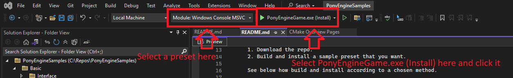

# Pony Engine Samples
Samples of projects on Pony Engine https://github.com/ZorPastaman/PonyEngine

Main branch always uses develop branch of the engine. Switch to a release branch to use a specific version of the engine.

All the samples load the engine automatically via CMake fetch content.
Prerequisites for the samples are the same as for the engine.

Every sample is a CMake preset.

## How to use

1. Download the repo.
2. Build and install a sample preset that you want.

See below how build and install according to a chosen method.

### Command line

1. Open the root folder of this repo in a command line.
2. Execute this chain of commands:
```
cmake --list-presets                 # Shows all the possible presets. Choose among them.
cmake --preset <preset>              # Configures the chosen preset.
cmake --build --preset <preset>      # Builds the chosen preset.
cmake --install "Build/<preset>"     # Install the chosen preset.
"Install/<preset>/PonyEngineGame"    # Launches the built project.
```

### Visual Studio

1. Open the repo folder in Visual Studio.
2. Select a preset.
3. Select `PonyEngineGame.exe (Install)` as a target to run.
4. Run the target.



## Presets

All the presets follow this logic in naming:

`<SampleName> <Platform> <Sub-Platform> <Compiler> - <Build type>`

Sub-platform options depend on a platform. For example, for `Windows` they are `Console` and `GUI`.

The preset display names and actual names are different. The actual names are shorter to avoid long paths.
The only part of the name that is never shortened is a sample name.

The samples don't have to support all the possible variants of build targets. In many cases it would be an overkill.
For example, many samples support only `Console` sub-platform on `Windows` cause they don't need to show something graphically
and it lets keep the sample very simple.

By default, all the engine modules are static libs, and those libs are linked to the application. 
But they can be grouped together into DLLs, and those DLLs will be linked to the application.
It's controlled via CMake variable `PONY_MAKE_GROUPS`. The groups are predefined and follow relationship logic: all the logging modules are grouped together, all the resource modules are grouped together etc.

### Platforms

#### `Windows`

Platform short name: `Win`.

| Sub-platform | Short name |
|:-------------|:-----------|
| Console      | Con        |
| GUI          | GUI        |

The console sub-platform creates a console application for `Windows`. The GUI sub-platform creates a normal `Windows` application.

### Compilers

#### `MSVC`

Compiler short name: `MSVC`.

MSVC requires some preparation before using CMake. You must set vc variables via `vcvarsall.bat`.
The details are here: https://learn.microsoft.com/en-us/cpp/build/building-on-the-command-line?view=msvc-170

If you use Visual Studio, it will do all the required preparations automatically.

### Build types

| Build type  | Short name | CMake build type | Engine optimization | Game optimization | Engine log level | Game log level | Engine log stacktrace level | Game log stacktrace level | Make groups |
|:------------|:-----------|:-----------------|:--------------------|:------------------|:-----------------|:---------------|:----------------------------|:--------------------------|:-----------:|
| Debug       | Deb        | Debug            | Debug               | Debug             | Debug            | Debug          | Error                       | Error                     | &check;     |
| Development | Dev        | Debug            | Release             | Debug             | Info             | Debug          | Fatal                       | Error                     | &check;     |
| Optimized   | Opt        | Debug            | Release             | Release           | Info             | Info           | Fatal                       | Fatal                     | &check;     |
| Release     | Rel        | RelWithDebInfo   | Release             | Release           | Warning          | Info           | Fatal                       | Fatal                     | -           |
| Shipping    | Shi        | Release          | Release             | Release           | Error            | Error          | Fatal                       | Fatal                     | -           |

## How it works

The root [CMakeLists.txt](CMakeLists.txt) runs builds this way.

First, it sets needed global params. The tricky part here is `import std;` support which was added in C\++ 23 and used by Pony Engine.
`std` module must be built first. For that `set(CMAKE_CXX_MODULE_STD ON)` must be set before a first project. But it's still experimental in CMake.
To activate it you must use `set(CMAKE_EXPERIMENTAL_CXX_IMPORT_STD "0e5b6991-d74f-4b3d-a41c-cf096e0b2508")`. The actual uuid depends on your CMake version.
To get a correct value, go to `https://github.com/Kitware/CMake/blob/<CMakeVersion>/Help/dev/experimental.rst`. Don't forget to change the version in the link for your CMake version.
If needed, change the uuid used in the repo to a correct value.

Also, the intersting part is this. CMake builds std module and applies compiler flags to it on a first project. That's why compiler flags must be set globally before it.
The toolchains do it for any preset. But as you may see among build types there are those where engine and optimizations are different.
To support that, the toolchains provide functions to clear flags (it's called after a first project immediately) and to set flags to targets individually.

Pony Engine provides some tools that must be built for a host platform. Mainly, they are used to build game resources.
But because CMake doesn't allow to mix builds for two different target platforms, the tools are built via ExternalProject inside a sample build.

All the engine modules that are supported by a target platform are turned on and built but sample targets have dependecies only on those engine modules that they actually use.

Main CMakeLists automatically adds a target of a selected sample. That's why they all have the target name `Sample`.
One of the most important parts is [EngineModulePostConfiguration](CMake/EngineModulePostConfiguration.cmake). 
It applies flags to built targets, creates DLL groups if requested and links the built modules to the application.

## Samples

| Sample group               | Description                                                                            |
|:---------------------------|:---------------------------------------------------------------------------------------|
| [Basic](Basic)             | Shows very basic usage of the engine. It's a great starting point to learn the engine. |
| [Application](Application) | Shows how to use different features of the application module.                         |

The samples don't cover all the functions of the engine. Please, refer to the engine documentation for more.
